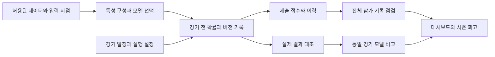

# KBO-predictor | 경기 승부예측의 운영과 검증

 [](LICENSE) [](https://github.com/jinwon25/KBO-predictor/actions/workflows/checks.yml)

KBO 경기의 승리 확률을 예측하고, 일정에 맞춘 실행·제출 접수·결과 대조·모델 평가를 연결한 4인 팀 프로젝트입니다. 2026 스탯티즈 대학생 승부예측 대회에 중앙대학교 **최강이조**로 참가했습니다. 데이터 처리·모델 개발·웹 대시보드·서버와 자동 제출 운영 전반에 참여했습니다.

이 저장소에는 운영 구조, 시즌 회고, 문헌에 근거한 다음 실험 설계와 독립적으로 만든 합성 데이터 데모를 담았습니다. 대회 원천 자료와 실제 학습 모델·제출 원장은 별도로 보존합니다.

## 현재 상태와 주요 결과

2026년 10월 13일 확인한 [주최 측 팀 페이지](https://www.statiz.co.kr/prediction/?m=university_detail&ptt_idx=70)의 공개 기록입니다.

| 항목 | 페이지 표기 |
| --- | ---: |
| 순위 | 16위 |
| 시즌 적중률 | 54.6% |
| 게임 참여수 | 689경기 |
| ALL KILL | 5회 |

표시 시점의 공개 기록이며, 별도 최종 심사·수상 결과를 뜻하지 않습니다. **게임 참여수와 적중률의 분모는 별도 항목**이므로 689에 적중률을 곱해 적중 수를 역산하지 않았습니다. 초반 수동 제출과 이후 원격 자동 운영이 함께 있는 전체 참가 기록이며, 특정 모델 하나의 성능으로 해석하지 않습니다. [시즌 결과와 평가 범위](docs/season-review-2026.md)

시즌 결산에서 확인한 후속 과제는 경기 전 입력의 정의·이용 시각 정합성, 투수 원시 카운트의 표본 수축, 확률 보정과 이후 기간 검증입니다. 아래 고도화안은 **설계 단계**이며, 새 모델의 개선 성과로 제시하지 않습니다. [연구 고도화 계획](docs/research-plan.md)

## 분석 질문과 자료

| 질문 | 검토 방법 |
| --- | --- |
| 예측과 제출을 경기 일정에 맞춰 연결할 수 있는가? | 실행 시각, 마감 전 접수, 취소·재편성, 모델 버전의 이력을 연결 |
| 과거 재구성 입력과 실제 경기 전 입력이 같은 의미인가? | 변수 정의·기본값·누적 종료일·원천 출처·관측 시각을 대조 |
| 승자 선택과 확률의 신뢰도를 함께 개선할 수 있는가? | 같은 경기의 적중률·Brier·LogLoss와 보정 곡선을 비교 |
| 모델 변경의 효과를 어떻게 검증할 것인가? | 날짜순 학습·보정·평가를 구분하고 고정한 후보의 이후 예측을 보존 |

운영 모델은 대회 제공 기록을 사용했습니다. 현재 서빙 진입점은 `predictor_v13`, 선택된 확률 모드는 `pit_lgbm_v1` 직접 확률 LightGBM입니다. 기존 Rule·Elo/Glicko-2·LightGBM 스태킹의 설계와 실제 서빙을 구분해 기록합니다. 제공 자료의 이용 조건과 기존 운영 경로의 확인 범위는 [데이터·공개 정책](docs/data-policy.md)을 참고하세요.

## 구현과 연구에서 한 일



| 영역 | 구현·점검한 내용 | 평가할 때의 구분 |
| --- | --- | --- |
| 예측 | 경기 카드, 홈·원정 승리 확률, 선발·불펜·타선 비교 지표 | 화면에 보이는 지표와 실제 모델 입력의 의미를 대조 |
| 운영 | 일정 조회, 예약 실행, 자동 제출, 접수 이력, 취소·재편성 처리 | 실행 성공과 주최 측 접수 성공을 분리 |
| 결과 분석 | 모델별 적용 기간·표본 수, 월별·요일별·팀별 집계 | 서로 다른 날짜의 모델 성적을 직접 비교하지 않음 |
| 관리 | 모델 선택, 실행·서버 로그, 산출물 보관, 버전 확인 | 코드·가중치·입력·제출값의 추적 가능성을 유지 |
| 시즌 결산 | 일정과 보존 예측 대조, 동일 경기 비교, 확률 보정·입력 차이 점검 | 전체 참가 성적, 내부 평가, 사후 재구성, 동결 후보 평가를 구분 |

[시스템 구조](docs/architecture.md)와 [시즌 회고](docs/season-review-2026.md)에 목적·판단·남은 한계를 정리했습니다. 팀 작업 전체를 단독 개발 성과로 표현하지 않으며 개인 기여율은 산정하지 않았습니다.

## 다음 연구의 우선순위

1. 입력 정의와 이용 가능 시각을 고정하고 과거 재구성·실전 입력의 정합성을 확인합니다.
2. 예측일 이전 SO·BB·TBF로 K%·BB%·K%-BB%와 표본 수축 후보를 만듭니다.
3. 리그 득점 환경에 대한 상대 지표 로지스틱과 규제를 둔 소형 트리를 같은 날짜 분할에서 비교합니다.
4. 독립 보정 구간에서 낮은 자유도의 보정을 학습하고 이후 경기의 확률 품질을 평가합니다.
5. 최종 후보·평가 기간을 사전에 고정해 제출 품질과 모델 성능을 새 기간에서 확인합니다.

이 우선순위는 프로젝트 점검과 논문·공식 문서를 종합한 연구 판단입니다. 문헌의 다른 데이터셋 성과를 KBO 개선 수치로 가져오지 않습니다. [실험별 가설·통과 기준](docs/research-plan.md) · [실험 기록 양식](docs/experiment-log.md) · [참고 문헌과 적용 범위](docs/references.md)

## 공개 예제 실행과 검증

공개 예제는 가상의 팀·경기·확률을 독립적으로 생성하는 읽기 전용 데모입니다. 실제 운영 화면·모델 추론·자동 제출을 재현하지 않습니다. 기존 데모 화면은 [합성 데이터 데모 안내](docs/demo.md)에 별도로 구분했습니다.

Python 3.11 이상에서 추가 패키지 없이 실행할 수 있습니다.

```bash
git clone https://github.com/jinwon25/KBO-predictor.git
cd KBO-predictor
python -m demo.server
```

브라우저에서 `http://127.0.0.1:5080`을 엽니다. 종료는 `Ctrl+C`입니다.

```bash
python -m unittest discover -s tests -v
python tools/check_publication.py
```

테스트는 확률 정규화, 제출 마감 경계, 미제출·제외 경기, 집계 일관성과 읽기 전용 HTTP 동작을 검증합니다. 데모 테스트 통과와 실제 모델 성능은 별도의 확인 결과입니다.

## 문서와 저장소 구성

| 경로 | 내용 |
| --- | --- |
| [docs/README.md](docs/README.md) | 문서 읽기 순서와 용어 |
| [docs/season-review-2026.md](docs/season-review-2026.md) | 공개 참가 결과, 수동·자동 운영 이력과 평가 범위, 회고 |
| [docs/research-plan.md](docs/research-plan.md) | 후속 실험의 가설·시점 조건·비교 기준 |
| [docs/experiment-log.md](docs/experiment-log.md) | 계획·실행·실패·보류를 구분하는 기록 양식 |
| [docs/references.md](docs/references.md) | 논문·공식 문서와 이 프로젝트에 적용할 범위 |
| [docs/architecture.md](docs/architecture.md) | 운영 책임 구분과 공개 데모 설계 |
| [docs/data-policy.md](docs/data-policy.md) | 자료 보존·공개 범위와 규정 확인 한계 |
| `demo/`, `web/`, `tests/` | 독립 합성 데이터와 데모 UI·검증 |
| `tools/`, `.github/workflows/` | 공개 파일 검사와 CI |

대회 원천 자료·실제 API 응답·경기별 제출 원장·학습 가중치·인증 정보·운영 주소·팀 제출 문서·논문 원문을 포함하지 않습니다. 주최 측의 공개 팀 기록은 출처와 조회 날짜를 함께 인용하며, 내부 산출물과 참가 자료는 별도로 보존합니다.

마지막 정리: 2026-10-13. 공개 코드의 [MIT 라이선스](LICENSE)는 대회 데이터나 제3자 자료의 이용 권한을 부여하지 않습니다.

함께 볼 분석: [투수 피로 신호와 교체 의사결정](https://github.com/jinwon25/KBO-pitcher-fatigue) · [데이콘 분석·예측 대회 기록](https://github.com/jinwon25/Dacon).
