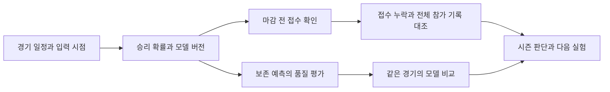

# KBO-predictor | 승부예측의 시즌 결산과 검증

 [](LICENSE) [](https://github.com/jinwon25/KBO-predictor/actions/workflows/checks.yml)

**경기 전 승리 확률을 만드는 일부터 마감 전 접수와 시즌 평가까지 연결한 분석·운영 프로젝트입니다.** 2026 스탯티즈 대학생 승부예측 대회에 중앙대학교 **최강이조**, 4인 팀으로 참가했습니다. Python으로 데이터 처리·모델 연구·웹 대시보드·서버와 자동 제출을 연결하고, 시즌 종료 후 기록의 완전성과 모델 비교 조건을 점검했습니다.

공개본에는 참가 결과, 분석에서 내린 판단, 운영 UI 기록과 독립 합성 예제가 있습니다. 실제 운영 모델의 전체 재현에는 별도로 보존한 원천 자료·입력·가중치가 필요합니다.

## 시즌 결과와 핵심 판단

[주최 측 팀 페이지](https://www.statiz.co.kr/prediction/?m=university_detail&ptt_idx=70)를 **2026년 10월 14일** 조회한 기록입니다.

| 순위 | 시즌 적중률 | 게임 참여수 | ALL KILL |
| ---: | ---: | ---: | ---: |
| 16위 | 54.6% | 689경기 | 5회 |

조회 시점의 공개 표기이며 최종 심사·수상 발표를 뜻하지 않습니다. **게임 참여수는 적중률의 분모로 확인된 값이 아닙니다.** 689에 54.6%를 곱해 적중 수를 역산하지 않았습니다. 초반 수동 제출과 이후 자동 운영, 여러 모델이 포함된 팀 전체 기록입니다.

결산에서 얻은 핵심은 다음 세 가지입니다.

| 분석으로 확인한 문제 | 내린 판단 | 이어지는 작업 |
| --- | --- | --- |
| 보존 예측, 접수 증거, 공식 참가 기록의 범위가 다름 | 모델 성능과 제출 완결성을 별도 지표로 평가 | 경기번호별 일정·예측·접수·결과 대조 |
| 과거 재구성 입력과 실제 경기 전 입력의 정의·기본값을 대조할 필요 | 입력 정합성을 모델 복잡도 확대보다 우선 | 원천·분모·누적 종료일·가용 시각 고정 |
| 동일 경기에서 관측한 모델 차이에 불확실성이 남음 | 관측된 개선만으로 교체 효과를 확정하지 않음 | 후보를 동결하고 이후 기간에서 비교 |

[시즌 회고: 관측 → 판단 → 남은 과제](docs/season-review-2026.md) · [지표 정의와 실행 가능한 분석 예제](docs/evaluation-guide.md)

## 문제와 담당 범위

| 항목 | 내용 |
| --- | --- |
| 분석 질문 | 예측이 얼마나 맞는가, 마감 전 접수됐는가, 모델 변경의 차이를 믿을 수 있는가? |
| 관측 단위 | 경기 하나. 일정·예측·접수·결과를 경기번호로 연결 |
| 실제 자료 | 대회 제공 API 기록과 운영 중 보존한 입력·예측·접수 증거. 공개 범위는 [데이터 정책](docs/data-policy.md)에 명시 |
| 방법 | 경기 전 시점 검증, Rule·Elo/Glicko-2·LightGBM 연구, 동일 경기 비교, 적중률·Brier·LogLoss 평가 |
| 본인 역할 | 데이터 처리·모델 개발·웹 대시보드·서버와 자동 제출 운영 전반 참여. 개인 기여율 미산정 |
| 완료한 범위 | 예측·제출·결과 추적 시스템 운영, 시즌 결산과 원본 보존, 공개 설명·합성 예제 |
| 후속 과제 | 초기 접수 증거 대조, 입력 정의 정합성, 새 기간 평가. [고도화 실험](docs/research-plan.md)은 설계 단계 |

시즌 결산 시점의 실제 서빙은 `predictor_v13`의 `pit_lgbm_v1` 직접 확률 LightGBM입니다. 이전 Rule·Elo/Glicko-2·LightGBM 스태킹은 과거 설계·비교 대상으로 구분합니다. 팀 전체의 공식 성적을 특정 모델 또는 개인만의 성과로 환산하지 않았습니다.

## 분석과 운영의 연결



서버 실행 성공, 주최 측 접수 성공, 경기 결과 적중은 서로 다른 사건으로 기록했습니다. 월별·팀별 성적은 표본 수·모델 적용 시기와 함께 해석하며, 팀별 집계에서 한 경기가 양 팀에 포함되는 점을 고려합니다. [시스템 구조](docs/architecture.md)

## 운영 대시보드

아래는 **실제 운영 UI에 독립 합성 입력을 적용한 정적 기록**입니다. 2030년 가상 경기·선수·수치를 사용했으며 실제 성적 화면의 원본 캡처가 아닙니다.


경기별 확률 확인 → 일정에 맞춘 실행 → 접수 응답 대조 → 기간별 성적 확인의 흐름을 구현했습니다. [화면 6개와 운영 판단](docs/dashboard-showcase.md)에서 일정 설정·접수 응답·통계·모바일 화면까지 볼 수 있습니다.

저장소를 내려받아 `docs/showcase/index.html`을 브라우저에서 열면 서버 없이 확인할 수 있습니다. GitHub에서는 HTML이 소스 코드로 표시됩니다.

## 직접 확인할 수 있는 분석

**같은 예측도 분모와 접수 증거에 따라 다른 지표가 됩니다.** 독립 합성 9경기의 [지표 대조 예제](docs/evaluation-guide.md)는 다음 차이를 재현합니다.

| 합성 예제 지표 | 결과 | 의미 |
| --- | ---: | --- |
| 보존 예측 적중률 | 3/5 = 60.00% | 접수 여부와 별도로 보존 예측의 방향을 평가 |
| 마감 전 접수 확인분 적중률 | 1/3 = 33.33% | 접수가 확인된 부분집합만 평가 |
| 채점 대상의 접수 확인 비율 | 3/6 = 50.00% | 나머지를 모두 실제 미제출로 단정하지 않음 |
| 대회식 전체 적중률 | 확정 불가 | 접수 증거가 미확인인 1경기를 남겨 둠 |

이 숫자는 위의 실제 참가 성적과 무관합니다. 예제는 누락을 0으로 채워 성적을 확정하는 오류, 반올림 후 50% 판정, 확률 지표와 적중률의 차이를 설명합니다.

Python 3.11 이상에서 추가 패키지 없이 실행합니다.

```bash
git clone https://github.com/jinwon25/KBO-predictor.git
cd KBO-predictor
python -m demo.metric_audit
python -m unittest discover -s tests -v
python tools/check_publication.py
```

별도의 작은 대시보드 데모는 `python -m demo.server` 실행 후 `http://127.0.0.1:5080`에서 확인합니다. 종료는 `Ctrl+C`입니다. [합성 데모 안내](docs/demo.md)

공개 검증은 채점 경계·분모·미확인 상태·읽기 전용 HTTP·정적 화면을 확인합니다. 실제 모델의 학습·시즌 성능 재현과는 확인 범위가 다릅니다.

## 다음 연구

기존 모델 검증 E0–E5에 더해, 정보를 언제 확보하고 어떤 조건에서 예측을 신뢰할지와 운영 자동화의 효과를 연구합니다. [발전 방향 비교](docs/development-roadmap.md)에 8개 방향의 질문·자료·산출물·우선순위를 정리했습니다.

| 우선 방향 | 분석 질문 | 현재 상태 |
| --- | --- | --- |
| 데이터 품질·평가용 데이터마트 | 일정·예측·접수·결과의 누락과 차이가 평가에 어떤 영향을 주는가? | 설계 |
| 예측 시점의 정보 가치 | 경기 직전 정보를 기다릴 때 확률 품질과 처리 여유가 어떻게 바뀌는가? | 설계 |
| 실패 조건·단순 모델 비교 | 어떤 입력·상황에서 모델을 덜 믿어야 하는가? | 기존 E0–E4와 연결한 설계 |
| 제출 없는 포스트시즌 평가 | 정규시즌에서 고정한 모델이 다른 환경에서도 작동하는가? | [프로토콜](docs/postseason-protocol.md) 설계, 자료 이용 조건 확인 필요 |
| 시리즈 확률·민감도 | 경기 확률이 진출 확률과 예상 경기 수로 어떻게 연결되는가? | [독립 합성 예제](docs/series-scenarios.md) 구현·검증 |

시리즈 예제는 추가 패키지 없이 `python -m demo.series_scenarios`로 실행합니다. 무승부 없는 가상 시리즈에서 매 경기 승률을 55%로 고정하면 7전4선승 진출 확률은 60.83%입니다. 이는 입력 가정을 변환한 계산이며 실제 팀의 예측 성과가 아닙니다.

운영의 수동 개입·처리 지연 측정과 이용 조건이 명확한 별도 공개 자료의 재현 연구도 검토했습니다. 실제 자료의 신규 수집·포스트시즌 추론·모델 교체는 아직 실행하지 않았습니다. 이미 점검한 2026년 자료는 개발·회고 자료로 표시하고 이후 평가를 구분합니다.

[모델 연구 E0–E5](docs/research-plan.md) · [실험 기록 양식](docs/experiment-log.md) · [참고 문헌](docs/references.md)

## 상세 문서와 자료 조건

| 경로 | 읽을 내용 |
| --- | --- |
| [docs/README.md](docs/README.md) | 읽는 순서와 용어 |
| [docs/season-review-2026.md](docs/season-review-2026.md) | 참가 결과, 실제 관측과 판단, 미해결 범위 |
| [docs/evaluation-guide.md](docs/evaluation-guide.md) | 지표의 분자·분모·제외 조건과 9경기 계산 |
| [docs/development-roadmap.md](docs/development-roadmap.md) | 8개 발전 방향과 우선순위·완료 산출물 |
| [docs/postseason-protocol.md](docs/postseason-protocol.md) | 제출 없는 경기 전 평가의 시점·무승부·자료 조건 |
| [docs/series-scenarios.md](docs/series-scenarios.md) | 시리즈 진출 확률·예상 경기 수·가정 민감도 |
| [docs/dashboard-showcase.md](docs/dashboard-showcase.md) | 운영 UI와 각 화면에서 내리는 판단 |
| [docs/architecture.md](docs/architecture.md) | 운영 구성과 공개 데모의 재현 범위 |
| [docs/data-policy.md](docs/data-policy.md) | 자료 이용 조건·공개 범위·규정 확인 한계 |
| `demo/`, `web/`, `tests/` | 독립 합성 코드와 검증 |
| `tools/`, `.github/workflows/` | 공개 파일 검사와 CI |

실제 원천 자료·API 응답·경기별 제출 원장·학습 가중치·인증 정보·운영 주소·팀 제출 문서는 별도로 보존합니다. 초기 접수 원장과 추가 공지·참가 서약의 확인 범위가 남아 있어 전체 운영의 규정 적합성이나 사후 제출 완료를 인증하지 않습니다. 공개 코드의 [MIT 라이선스](LICENSE)는 대회 데이터나 제3자 자료의 이용 권한을 부여하지 않습니다.

문서·합성 분석 정리: 2026-10-14. 참가 성적의 조회 기준일: 2026-10-14.

함께 볼 분석: [투수 피로 신호와 교체 의사결정](https://github.com/jinwon25/KBO-pitcher-fatigue) · [데이콘 분석·예측 대회 기록](https://github.com/jinwon25/Dacon).
