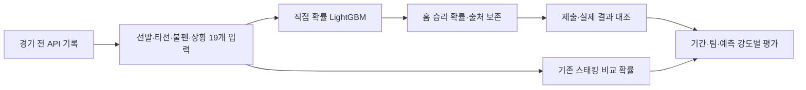
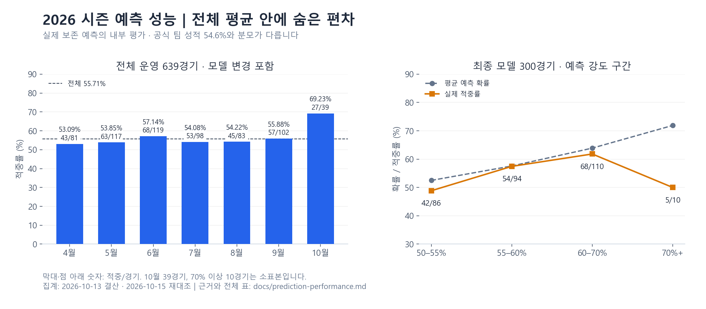
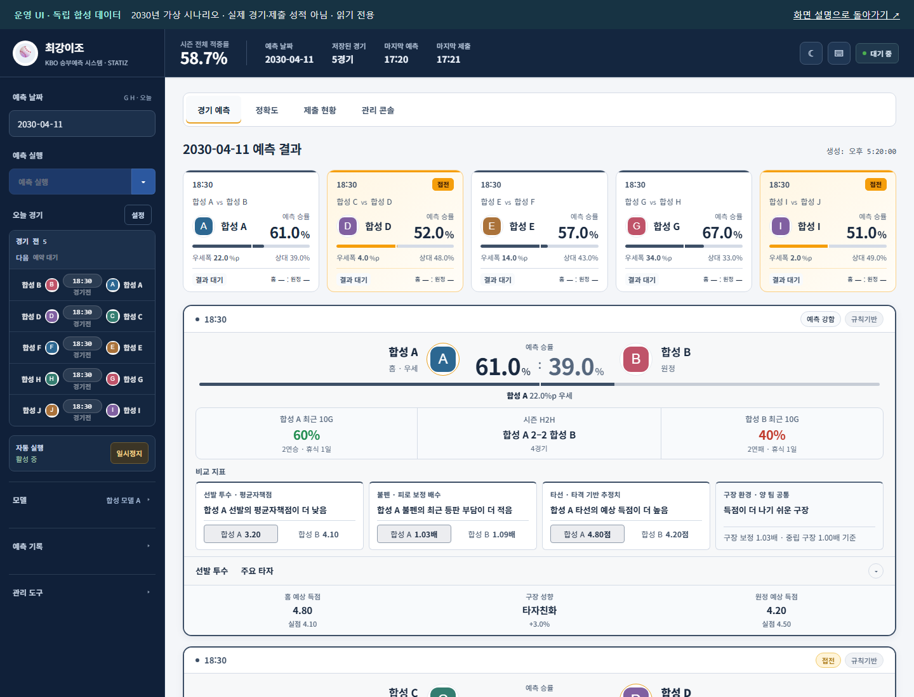

# KBO-predictor | KBO 승부예측 대회 참가 결산

 [](LICENSE) [](https://github.com/jinwon25/KBO-predictor/actions/workflows/checks.yml)

2026 스탯티즈 대학생 승부예측 대회에서 **경기 전 승리 확률 계산부터 마감 전 제출·결과 추적·시즌 평가까지** 운영한 4인 팀 프로젝트입니다. 중앙대학교 **최강이조**로 참가했으며, 데이터 처리·모델 개발·웹 대시보드·서버 운영에 참여했습니다.

이 저장소는 대회 참가 과정과 결과를 정리한 기록입니다. 공식 참가 성적, 모델링 구조, 실제 예측의 기간별·팀별 성능, 운영 대시보드와 독립 합성 예제를 담았습니다.

## 문서 읽기 안내

[문서 안내](docs/README.md)에서 목적별 읽는 순서와 용어를 확인할 수 있습니다. 모델과 결과는 [모델링 상세](docs/modeling.md)와 [예측 성능](docs/prediction-performance.md), 참가 경험은 [시즌 결산](docs/season-review-2026.md), 판단의 근거는 [운영 기록 분석](docs/operations-review.md)과 [지표 정의](docs/evaluation-guide.md)에 정리했습니다.

## 프로젝트 한눈에 보기

| 항목 | 내용 |
| --- | --- |
| 분석 질문 | 승리 확률은 얼마나 정확한가, 마감 전 접수됐는가, 모델별 성적을 같은 조건에서 비교할 수 있는가? |
| 대회·팀 | 2026 스탯티즈 대학생 승부예측 대회 · 중앙대학교 최강이조 · 4인 팀 |
| 관측 단위·자료 | 경기 하나. 대회 제공 API와 보존한 입력·예측·접수·결과를 경기번호로 연결 |
| 주요 방법 | 경기 전 입력 시점 점검 · 동일 경기 모델 비교 · Brier·LogLoss · SQL 대조 · 날짜·기간 단위 불확실성 분석 |
| 도구 | Python·LightGBM·Flask로 예측 및 웹 운영, SQLite·SQL로 시즌 결산 |
| 본인 역할 | 데이터 처리·모델 개발·웹 대시보드·서버 및 자동 제출 운영 전반 참여. 개인 기여율 미산정 |
| 산출물 | [시즌 결산](docs/season-review-2026.md) · [운영 UI 기록](docs/dashboard-showcase.md) · [평가 예제](docs/evaluation-guide.md) · [SQL 대조 예제](docs/operations-review.md) |
| 정리 상태 | 시즌 참가·운영 기록과 결산 분석 정리 완료. 아래 성적은 주최 측 페이지 조회 시점 기준 |

## 대회 결과

[주최 측 팀 페이지](https://www.statiz.co.kr/prediction/?m=university_detail&ptt_idx=70)를 **2026년 10월 14일** 조회한 표기입니다.

| 순위 | 시즌 적중률 | 게임 참여수 | ALL KILL |
| ---: | ---: | ---: | ---: |
| 16위 | 54.6% | 689경기 | 5회 |

초반 수동 제출과 이후 자동 운영, 여러 모델이 포함된 **팀 전체 기록**입니다. 게임 참여수는 적중률의 분모로 확인된 값이 아니므로 적중 수를 역산하지 않았습니다. 조회 시점의 표기를 최종 심사·수상 발표로 해석하지 않습니다.

## 모델링 구조

선발·타선·불펜·팀 흐름을 입력으로 경기의 홈 승리 확률을 계산했습니다. 초기 규칙 기반 모델에서 잔차 스태킹을 거쳐, 시즌 후반에는 **19개 입력을 받는 직접 확률 LightGBM**을 운영했습니다.



| 구분 | 실제 구성 |
| --- | --- |
| 이전 모델 | 규칙 확률·Elo·Glicko-2·LightGBM 잔차 bagging의 확률 스태킹 |
| 최종 운영 모델 | `predictor_v13` 안에서 선택한 `pit_lgbm_v1` 직접 확률 LightGBM |
| 학습 | 2025년 PIT 재구성 승패 698경기, 날짜순 검증으로 설정 선택 |
| 주요 입력 | 선발 ERA·최근 ERA·K/BB·QS, 라인업 wRC+·wOBA, 기대득실점, 불펜 피로·최근 흐름·홈/원정·구장 |
| 복잡도 제어 | 트리 100개, 학습률 0.03, 잎 수 5, 최소 잎 표본 120, L1·L2 규제 |
| 예측 설명 | 경기별 TreeSHAP 로짓 기여도, 입력 상태와 보조 야구 지표를 함께 확인 |

[모델링 상세](docs/modeling.md)에서 19개 입력의 정의, 이전 스태킹과 직접 모델의 차이, 입력 누출 점검과 학습·선택·운영 평가 구간을 확인할 수 있습니다.

## 실제 예측 성능

아래는 **보존 예측의 내부 평가**입니다. 위의 공식 팀 성적 54.6%와 분모가 다르며, 합성 데모 점수도 아닙니다.

| 평가 대상 | 기간 | 적중 / 경기 | 적중률 | Brier ↓ | LogLoss ↓ |
| --- | --- | ---: | ---: | ---: | ---: |
| 전체 운영 기록·여러 모델 혼합 | 2026-04-11–10-12 | 356/639 | 55.71% | 0.24948 | 0.69371 |
| 최종 직접 확률 LightGBM | 2026-07-07–10-12 | 169/300 | 56.33% | 0.24559 | 0.68491 |
| 같은 300경기의 기존 v13 비교 확률 | 동일 경기 | 163/300 | 54.33% | 0.25152 | 0.69753 |

Brier·LogLoss는 확률 오차로 낮을수록 좋습니다. 50% 고정 확률의 기준은 각각 0.25·0.69315입니다. 최종 모델의 ROC-AUC는 0.58632이며, 기존 모델 대비 추가 적중은 6경기(+2.00%p)입니다. 다만 날짜별 부트스트랩 95% 구간이 −3.90–+7.72%p로 0을 포함해 안정적인 우월성은 확인하지 못했습니다.



| 분석 관점 | 관측 결과 | 해석 |
| --- | --- | --- |
| 기간별 | 전체 보존 예측 4월 43/81, 10월 27/39(69.23%) | 월별 모델·대진·표본이 달라 10월 점수를 시즌 성능으로 대체하지 않음 |
| 팀별 | 최종 모델의 KT 경기 44/59(74.58%), LG 경기 26/61(42.62%) | 해당 팀 참가 경기의 승자 예측 성적. 팀 자체 승률과 구별 |
| 홈·원정 | 키움 참가 경기 중 홈 10/24, 원정 23/32 | 팀별·장소별 약점을 찾는 진단. 대진과 시점 차이를 함께 고려 |
| 예측 강도별 | 55–60% 구간 54/94, 70% 이상 5/10 | 높은 확률의 과신 가능성 점검. 10경기로 보정 효과를 확정하지 않음 |
| 이후 경기의 그림자 후보 | 상대 지표 Logistic 후보 64/91(70.33%), 동일 경기 운영 모델 59/91 | 실제 제출 성적과 분리한 소표본 후보 평가 |

[예측 성능 상세](docs/prediction-performance.md)에 **전체·현 모델 월별 표, 10개 팀의 홈/원정 표, 예측 강도와 선택 방향, 모델 이력, 동일 경기 비교·불확실성**을 정리했습니다. 시즌 완료 720경기에서 평가 가능한 639경기까지의 누락·제외 조건과 수치 근거도 함께 제공합니다.

## 분석 과정과 주요 판단

| 다룬 문제 | 수행한 분석·구현 | 결산에서 내린 판단 |
| --- | --- | --- |
| 최신 입력 확보와 제출 마감의 균형 | 라인업 갱신 특성을 고려해 경기 30분 전 실행, 생성·접수 시각과 마감 여유 대조 | 실행 목표와 실제 접수 완료를 구분해야 운영 상태를 설명할 수 있음 |
| 예측 적중률과 참가 성적의 차이 | 일정·예측·접수·결과를 SQL로 연결하고 분모·누락·제외 조건 대조 | 예측 품질과 제출 완결성을 각각 평가. 접수 미확인을 미제출로 단정하지 않음 |
| 모델 변경의 효과 | 동일 경기에서 현·이전 모델의 확률과 적중 비교, 구간·월별 진단과 블록 크기 민감도 확인 | 관측된 개선에 불확실성이 남아 안정적인 우위로 확정하지 않음 |
| 과거 재구성과 실제 입력의 차이 | 입력 정의·기본값·누적 종료일·경기 전 보존 여부 점검 | 사후 재구성 점수를 당시 제출 성적으로 합치지 않음 |

### 1. 예측을 실제 제출까지 연결

초반 수동 제출 이후 원격 서버에서 일정 확인, 예측 실행, 제출 기록, 결과 집계와 대시보드를 연결했습니다. **경기 시작 30분 전 실행은 API의 당일 라인업이 60–30분 전에 갱신되는 운영 관측을 반영한 선택**입니다. 대회 마감인 15분 전까지 계산·전송·응답 확인을 위한 시간을 두었습니다.

시즌 결산에서는 성공 응답 기록의 마감 여유를 확인했습니다. 30분 전은 실행 목표이며 접수 완료 시각과 다릅니다. 라인업의 모든 갱신 시각을 관측한 자료는 아니므로 이 설정이 최적이라고 주장하지 않았습니다. [운영 판단과 시간 대조](docs/operations-review.md)

### 2. 성적을 설명하기 전에 분모와 증거를 대조

보존 예측, 접수 증거, 주최 측 참가 기록의 범위가 같지 않았습니다. 일정에서 출발해 예측 없는 경기도 남기고, 여러 접수 이벤트는 마감 전 마지막 성공 한 건으로 정리했습니다. SQL 집계는 기존 결산 및 원천 일정과 대조했습니다.

이 과정에서 **확률이 맞았는지와 실제 접수됐는지는 별개의 질문**으로 평가했습니다. 독립 합성 예제에서는 보존 예측 적중률이 3/5인 반면 마감 전 접수 확인분 적중률은 1/3입니다. 실제 참가 성적이 아니라 분모 차이를 설명하는 예제입니다. [지표 정의와 계산](docs/evaluation-guide.md)

### 3. 모델 성능을 같은 경기에서 해석

시즌 결산 시점의 서빙은 `predictor_v13`의 `pit_lgbm_v1` 직접 확률 LightGBM입니다. 이전 Rule·Elo/Glicko-2·LightGBM 스태킹은 과거 설계·비교 대상으로 구분했습니다.

운영 기간이 다른 모델의 평균 점수만으로 순위를 매기지 않고, 같은 경기의 확률·적중 차이와 불확실성을 점검했습니다. 확률 차이가 큰 구간의 개선과 월별 편차도 함께 보고, 유리한 구간만으로 모델 우위를 설명하지 않았습니다. [결산 사례와 해석](docs/season-review-2026.md)

## 운영 대시보드

경기별 확률 확인 → 일정에 맞춘 실행 → 제출 응답 대조 → 기간별 성적 확인의 흐름을 구현했습니다.



위 화면은 **실제 운영 UI에 독립 합성 입력을 적용한 정적 기록**입니다. 2030년 가상 경기·선수·수치를 사용했습니다. [화면 6개와 운영 판단](docs/dashboard-showcase.md)에서 일정 설정·제출 응답·통계·모바일 화면을 확인할 수 있습니다.

## 대회를 통해 얻은 점

모델의 예측력뿐 아니라 입력이 준비되는 시각, 제출 응답, 결과와의 연결까지 관리해야 시즌 성적을 설명할 수 있었습니다. 데이터 분석과 운영을 연결하는 과정에서 지표의 분모를 정의하고, 누락과 미확인을 구분하며, 관측된 모델 차이를 과장하지 않는 판단이 중요했습니다.

본인은 데이터·모델·웹·서버 운영에 걸쳐 참여했고, 결산에서는 그 과정을 기록과 재현 예제로 정리했습니다. 자동화에 따른 시간 절감이나 특정 모델만의 공식 성적 기여는 별도로 측정한 성과로 제시하지 않았습니다.

## 프로젝트 실행

Python 3.11 이상에서 추가 패키지 없이 실행합니다. 공개본은 실제 자료를 변형한 데이터가 아닌 **독립 합성 입력**을 사용합니다.

```bash
git clone https://github.com/jinwon25/KBO-predictor.git
cd KBO-predictor
python -m demo.metric_audit
python -m demo.operations_audit
python -m unittest discover -s tests -v
python tools/check_publication.py
```

작은 대시보드 데모는 `python -m demo.server` 실행 후 `http://127.0.0.1:5080`에서 확인하며, `Ctrl+C`로 종료합니다. [데모 안내](docs/demo.md)

운영 UI 정적 기록은 내려받은 `docs/showcase/index.html`을 브라우저에서 열면 됩니다. GitHub에서는 HTML이 소스 코드로 표시됩니다. 공개 테스트는 채점 경계·분모·SQL 결합·시간대·HTTP·정적 화면을 검증하며 실제 운영 모델의 학습·시즌 성능 재현과 범위가 다릅니다.

## 주요 문서와 파일 구조

| 경로 | 읽을 내용 |
| --- | --- |
| [docs/README.md](docs/README.md) | 목적별 문서 안내와 용어 |
| [docs/modeling.md](docs/modeling.md) | 19개 입력·직접 확률 LightGBM·이전 스태킹·시점 검증 |
| [docs/prediction-performance.md](docs/prediction-performance.md) | 실제 월별·팀별·홈/원정·확률 구간 성능과 비교 |
| [docs/season-review-2026.md](docs/season-review-2026.md) | 참가 결과·담당 범위·분석 판단·배운 점 |
| [docs/operations-review.md](docs/operations-review.md) | 30분 전 실행 근거·SQL 대조·접수 여유·모델 비교 |
| [docs/evaluation-guide.md](docs/evaluation-guide.md) | 지표의 분모·제외 조건·미확인 상태와 계산 |
| [docs/dashboard-showcase.md](docs/dashboard-showcase.md) | 운영 UI와 화면별 판단 |
| [docs/architecture.md](docs/architecture.md) | 운영 시스템과 공개 데모의 구성 |
| [docs/data-policy.md](docs/data-policy.md) · [docs/references.md](docs/references.md) | 자료 공개 범위와 출처 |
| `demo/` · `web/` · `tests/` | 독립 합성 분석·웹 데모와 검증 |
| `tools/` · `.github/workflows/` | 공개 파일 검사와 CI |

## 데이터 범위와 해석 제한

- 공식 참가 기록, 보존 예측의 내부 평가, 합성 예제 수치를 구분합니다.
- 초기 접수 기록의 확인 범위가 제한되어 전체 시즌의 접수 여부를 독립적으로 복원한 것은 아닙니다.
- 실제 API 응답·경기별 원장·학습 가중치·인증정보·운영 서버 원본은 별도 보존합니다. 공개 clone만으로 전체 학습과 시즌 점수를 재현할 수는 없습니다.
- 원본 보존·검증 완료와 주최 측 사후 제출 접수·수상 심사는 별개입니다. 자료 조건과 확인 범위는 [공개 정책](docs/data-policy.md)에 기록했습니다.

공개 코드의 [MIT 라이선스](LICENSE)는 대회 데이터나 제3자 자료의 이용 권한을 부여하지 않습니다.

함께 볼 분석: [KBO 투수 피로 신호와 교체 의사결정](https://github.com/jinwon25/KBO-pitcher-fatigue) · [데이터 분석·예측 대회 기록](https://github.com/jinwon25/Dacon) · [이커머스 고객 세분화](https://github.com/jinwon25/ecommerce-customer-segmentation).

최진원 · [GitHub](https://github.com/jinwon25) · 공식 성적 조회: 2026-10-14 · 모델·성능 문서 보완: 2026-10-15
