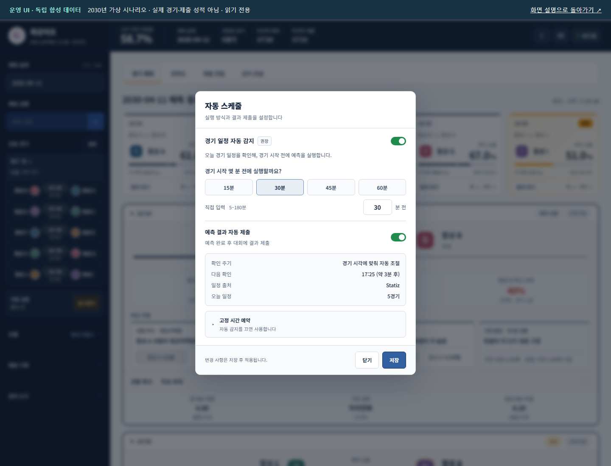
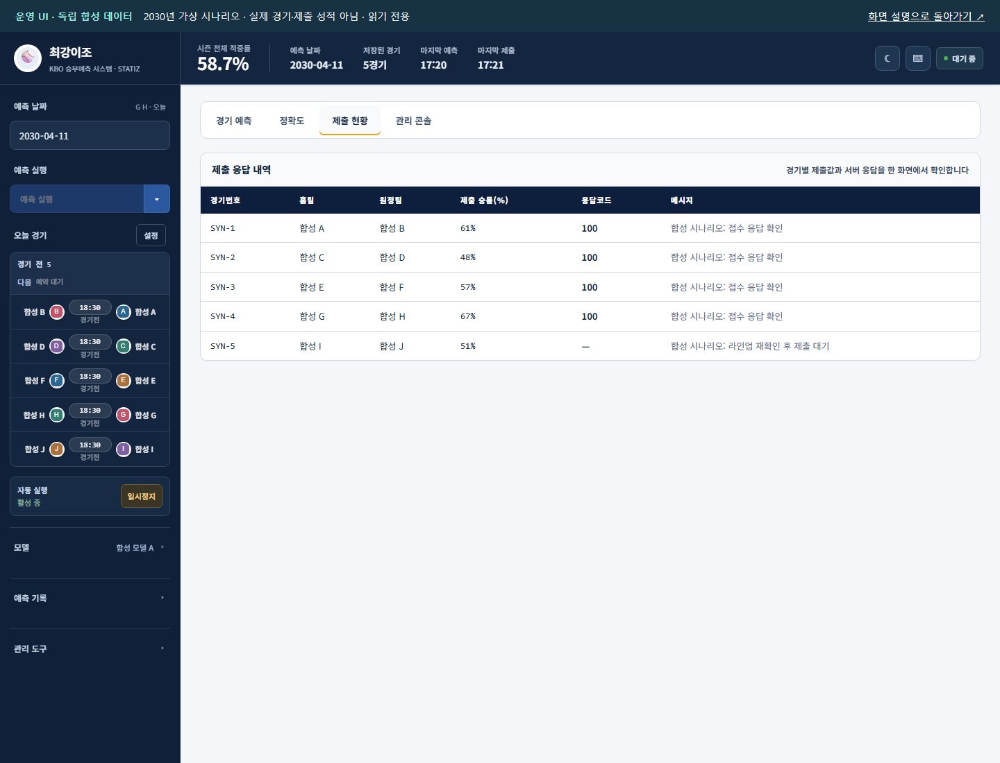
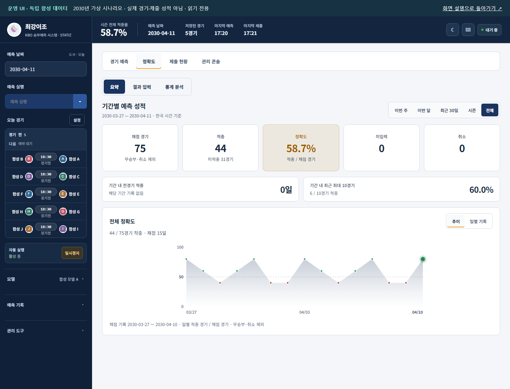
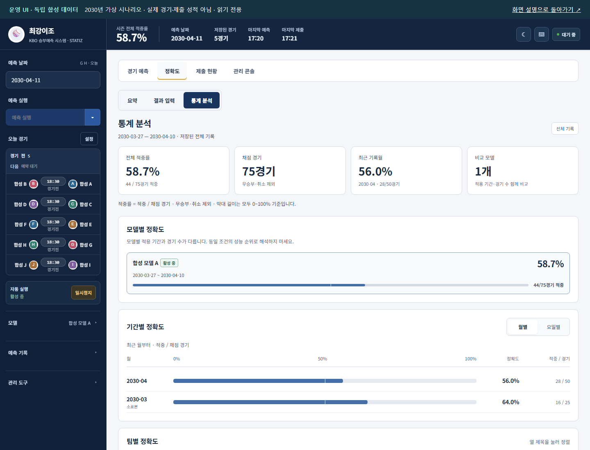
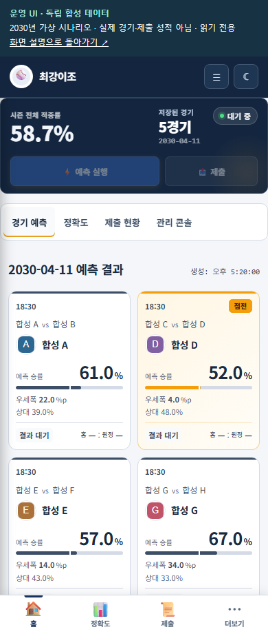

# 원격 운영 대시보드 화면 기록

원격 서버에서 사용한 대시보드의 구조와 운영 판단을 공개 기록으로 정리했습니다. 경기별 승리 확률을 확인한 뒤, 일정에 맞춰 실행하고 제출 응답·결과 집계를 대조하는 흐름을 보여줍니다.

[문서 안내](README.md) · [2026 시즌 회고](season-review-2026.md) · [오프라인 화면 모음](showcase/index.html)

## 먼저 보는 세 가지

1. **예측과 입력 상태**: 홈·원정 확률, 접전, 선발·라인업 상태와 비교 지표를 확인합니다.
2. **실행과 접수**: 일정에 따른 예측 실행과 주최 측 접수 응답을 별도로 추적합니다.
3. **성능과 분모**: 기간별 적중·미입력·취소와 모델의 적용 기간·표본 수를 함께 봅니다.

참가 결과와 운영 판단은 [시즌 회고](season-review-2026.md)와 [운영 기록 분석](operations-review.md)으로 연결합니다. 그림만으로 모델 성능이나 운영 안정성을 증명하지 않습니다.

## 기록 방식과 공개 범위

| 항목 | 이번 기록의 범위 |
| --- | --- |
| 화면 출처 | 2026-10-13에 조회한 실제 원격 운영 페이지의 HTML·스타일 |
| 이미지 | 운영 UI에 독립 합성 입력을 적용한 로컬 렌더링. 실제 서버 데이터 화면의 원본 캡처가 아님 |
| 표시 데이터 | 실제 경기에서 추출하지 않은 2030년 가상 팀·선수·경기·확률·응답 |
| HTML | 표시가 끝난 DOM을 고정한 정적 문서. 원본 JavaScript·이벤트 처리·외부 연결·제출 기능 제거 |
| 데스크톱·모바일 | 1440 × 1100, 390 × 920에서 표시 확인 |
| 화면 조정 | 공개 안내 띠 추가, 시스템 글꼴·가상 팀 문자 로고 사용, 외부 장식용 아이콘 의존성 제거 |
| 성적 인용 | 공식 팀 성적과 실제 예측 집계는 별도 성능 문서에서 구분. 화면 수치는 합성 예시 |
| 제외 | 원천 데이터·모델·실제 예측/접수 원장·키·서버 주소·서버 및 모델 실행 코드 |

상단 안내 띠를 HTML과 각 이미지에 함께 넣었습니다. HTML은 스크립트·네트워크 연결·폼 제출을 차단하는 CSP를 포함하며 조작 버튼을 비활성화했습니다. 링크와 스크롤로 기록을 읽을 수 있지만 실제 운영 기능은 실행하지 않습니다.

가상 과거 기록은 15일 × 5경기 = 75경기, 적중 44경기로 독립 생성했습니다. 가상 당일 5경기의 확률과 제출 응답도 별도로 작성했습니다. **화면의 58.7%는 실제 참가 성적 54.6%와 무관합니다.**

## 대시보드가 답한 분석 질문

운영 화면에는 경기 카드 외에도 아래의 분석 경로가 있습니다. 화면 구성의 합성 예시와 실제 시즌 성능 표를 연결해, 무엇을 확인하고 어떤 판단을 내렸는지 읽을 수 있게 했습니다.

| 분석 경로 | 실제 운영 화면에서 확인한 내용 | 이번 결산에서 연결한 결과 |
| --- | --- | --- |
| 기간 선택·날짜별 성적 | 선택 기간의 채점 경기·적중·미입력·취소, 날짜별 흐름 | [전체 639경기·최종 모델 300경기의 월별 성적](prediction-performance.md#3-기간별-전체-시즌과-최종-모델을-나누어-보기) |
| 팀별·홈/원정 통계 | 참가 팀별 경기 수·적중률과 홈/원정 역할 | [10개 팀의 전체·홈·원정 결과](prediction-performance.md#4-팀별홈원정-어느-경기에서-어려웠는가) |
| 모델별 적용 구간 | 모델별 표본 수·실제 확률 출처·적용 기간 | [모델 이력과 이후 경기 평가](prediction-performance.md#6-모델-이력과-이후-경기의-그림자-평가) |
| 최근 성능 | 최근 20·30·50·100경기 요약, 20경기 이동 적중률 | 누적 평균에 가려지는 최근 악화 탐지. 경기 수 창과 달력 기간을 구분 |
| 확률 신뢰도 | 5개 동일 표본수 보정 구간, 분포·구간별 표본과 Gap | [최종 모델 예측 강도별 실제 적중](prediction-performance.md#5-예측-강도-높은-확률을-얼마나-믿을-수-있었는가) |
| 경기 분석 | 선택 경기의 입력 비교·TreeSHAP·최근 오예측 | [19개 입력과 모델 내부 기여도](modeling.md) |
| 운영 상태 | 일정 수집→입력 생성→예측→제출 대기→결과 반영 | 예측 오차와 입력·접수 문제를 분리 |

팀별 집계는 한 경기를 양 팀에 포함합니다. 팀별 홈/원정과 모델이 홈/원정 중 어느 쪽을 골랐는지도 서로 다른 분할입니다. 최근 20경기 이동값은 창이 겹치므로 각 시점을 독립 검증 점수처럼 해석하지 않습니다.

확률 구간의 `Gap = 평균 예측 확률 − 실제 적중률`에서 양수는 과신 방향입니다. 운영 화면은 15경기 미만을 소표본 신호로 표시합니다. 실제 시즌 보고서는 독자가 비교하기 쉬운 고정 예측 강도 구간을 별도로 사용하므로 화면의 동일 표본수 구간과 수치가 다를 수 있습니다.

모델 인사이트의 성능·보정·경기 설명 기능은 운영 소스 `model_insights.py`와 내부 화면 가이드에서 확인했습니다. 아래 6개 정적 화면은 기존 공개 기록이며 인사이트 화면 전체를 캡처한 자료는 아닙니다. 실제 결과는 새 [성능 결산 표·차트](prediction-performance.md), 화면 배치와 사용 흐름은 합성 UI 기록에서 확인합니다.

## 화면과 운영 판단

### 1. 경기 예측

승리 확률과 접전 여부를 먼저 보고, 선발·불펜·타선·구장 비교 지표를 함께 확인합니다. 모델의 확률과 화면의 보조 지표를 구별합니다. 비교 지표는 인과적 승패 원인이라는 뜻이 아닙니다.

[읽기 전용 HTML](showcase/prediction.html)

### 2. 일정과 예약 실행

경기 일정 자동 감지, 경기 시작 전 실행 시각, 자동 제출 여부를 한 곳에서 설정합니다. 마감 전 실행과 접수 확인은 서로 다른 단계입니다. 수동 제출 이후 일정에 따른 실행과 접수 확인을 연결한 운영 구조를 보여줍니다.

[읽기 전용 HTML](showcase/schedule.html)

### 3. 제출 응답

경기별 제출 확률·응답 코드·메시지로 접수 확인과 대기 상태를 구분합니다. 그림의 4건 접수·1건 대기는 가상 시나리오입니다. 실제 접수율이나 가동률 측정값이 아닙니다.

[읽기 전용 HTML](showcase/submission.html)

### 4. 기간별 성적

채점 경기·적중·미입력·취소를 분리하고, 선택 기간의 날짜별 적중 흐름을 확인합니다. 가상 기록 75경기 중 44경기 적중입니다. 주최 측 참가 기록 54.6%와 무관합니다.

[읽기 전용 HTML](showcase/accuracy.html)

### 5. 통계 분석

모델 적용 기간·표본 수, 팀별 홈·원정 성적과 월별 집계를 확인합니다. 서로 다른 기간의 모델 성적은 동일 경기 비교가 아니므로 우열을 바로 판정하지 않습니다.

[읽기 전용 HTML](showcase/statistics.html)

### 6. 모바일 확인

좁은 화면에서는 요약 카드와 하단 메뉴로 경기·성적·제출을 확인합니다. 390 × 920 화면의 반응형 표시 기록입니다. 실제 휴대폰의 모든 환경을 검증했다는 뜻은 아닙니다.

[읽기 전용 HTML](showcase/mobile.html)

## HTML 열기

GitHub는 HTML 파일을 코드로 표시합니다. 저장소를 clone하거나 **Code → Download ZIP**으로 내려받은 뒤 `docs/showcase/index.html`을 브라우저에서 열면 화면 설명과 6개 정적 기록을 볼 수 있습니다. API 키·Python 패키지·운영 서버가 필요하지 않습니다.

기존 [합성 데이터 데모](demo.md)는 별도로 작성한 작은 실행 예제입니다. 이번 정적 기록은 실제 운영 화면 구성을 보여주므로 두 자료의 목적과 재현 범위가 다릅니다.

## 짧은 설명 순서

| 순서 | 설명할 내용 | 근거 |
| --- | --- | --- |
| 1 | 승리 확률 생성과 일일 제출을 연결해야 하는 문제 | [README](../README.md), 경기 예측·일정 설정 화면 |
| 2 | 초반 수동 제출과 이후 원격 운영 경험 | [시즌 회고](season-review-2026.md), 제출 응답 화면 |
| 3 | 결과를 과장하지 않는 평가 방식 | 공식 참가 기록, 기간·표본을 표시한 성적 화면 |
| 4 | 실제 수행한 SQL 대조·접수 여유·모델 비교와 해석 | [운영 기록 분석](operations-review.md), [지표 정의](evaluation-guide.md) |

초기 원격 운영 시작일과 수동 제출 접수 원장 전체는 확정하지 않았습니다. 현재 화면이 있다는 이유로 대회 전체 기간에 자동 운영했다고 표현하지 않습니다. 팀 전체 작업과 개인 기여도도 구분합니다.

## 참고 자료와 적용

| 자료 | 적용한 판단 |
| --- | --- |
| [Microsoft: 대시보드 설계 팁](https://learn.microsoft.com/en-us/power-bi/create-reports/service-dashboards-design-tips) | 먼저 읽을 핵심 정보를 앞에 두고 수치에 맥락을 제공. 원격 화면을 새로 설계한 성과로 주장하지 않음 |
| [W3C WAI: 정보성 이미지](https://www.w3.org/WAI/tutorials/images/informative/) | 각 이미지의 목적을 설명하는 대체 텍스트와 본문 캡션 제공 |
| [GitHub: 기본 작성·서식](https://docs.github.com/en/get-started/writing-on-github/getting-started-with-writing-and-formatting-on-github/basic-writing-and-formatting-syntax) | 상대 이미지·문서 링크로 README와 상세 기록을 연결 |
| [주최 측 공식 정책](https://www.statiz.co.kr/board/?b_code=10000&b_idx=4294959131&m=main&mode=view) | 제공 자료의 재배포 대신 독립 합성 입력 사용. 종료 후 제출 의무와 공개 허용을 분리 |

확인일: 2026-10-13. 화면 설명과 공개 범위를 정리할 때 참고했습니다.
