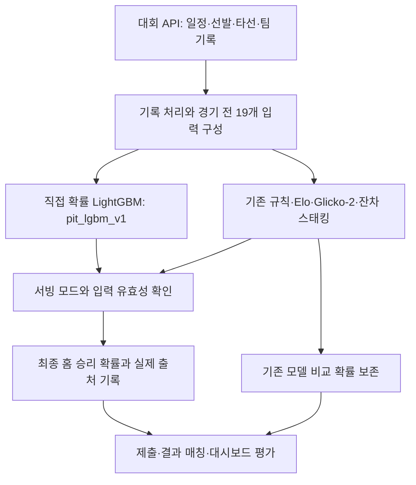

# 모델링 구조와 검증 설계

경기 전 선발·타선·불펜·팀 흐름을 홈 승리 확률로 연결했습니다. 도메인 규칙과 잔차 스태킹을 거쳐, 시즌 후반에는 **19개 입력으로 승리 확률을 직접 학습하는 LightGBM**을 운영했습니다. 파일 이름 `predictor_v13`과 실제 확률 출처 `pit_lgbm_v1`을 구분해야 최종 모델의 성능을 올바르게 읽을 수 있습니다.

[문서 목록](README.md) · [실제 예측 성능](prediction-performance.md) · [시스템 구조](architecture.md)

## 1. 무엇을 예측하는가

관측 단위는 경기 하나이며 목표값은 홈 승리 1, 원정 승리 0입니다. 무승부는 이진 승패 학습·평가에서 제외합니다. 대회 제공 API의 일정, 선발·라인업, 선수 기록, 팀 기록과 상대 전적을 처리해 경기 전 입력을 구성합니다. 외부 논문은 방법론 참고이며 외부 야구 데이터를 운영 입력으로 추가했다는 뜻이 아닙니다.

API의 당일 라인업 갱신과 제출 마감을 고려해 경기 시작 30분 전 실행을 목표로 했습니다. 실제 입력의 기준 시점과 접수 시각은 별도로 남겨, 나중에 재구성한 자료와 당시 예측을 구별했습니다.

## 2. 최종 운영 확률이 만들어지는 경로

`predictor_v13`은 운영 진입점입니다. 모드가 `pit_lgbm_v1`이고 모델과 입력이 유효하면 직접 확률을 선택합니다. 19개 키가 모두 있고 값이 유한한 수인지 검사합니다. 경기별 입력 검증이나 추론이 실패하면 기존 확률을 선택하고 실제 출처를 기록합니다. 다만 직접 모델 모드에서 유효한 아티팩트 없이 시작하면 초기화를 실패시키며, 실행 중 아티팩트 갱신이 실패하면 마지막 정상 묶음을 유지합니다. 이 세 상황을 같은 복귀 동작으로 해석하지 않습니다. 직접 모델 출력은 0.01–0.99로 제한합니다. 입력 유효성 검사가 기본값의 야구적 의미까지 보증하는 것은 아닙니다.

### 19개 입력: 숫자가 야구에서 뜻하는 것

차이 변수는 모두 **홈 값 − 원정 값**입니다. ERA·실점은 낮을수록 좋으므로 차이의 양수가 항상 홈 우세를 뜻하지 않습니다. 기대득점·실점과 피타고리안 확률은 앞 단계의 파생 추정값이며 실제 경기 결과를 넣은 값이 아닙니다.

| 묶음 | 입력 이름 | 의미 |
| --- | --- | --- |
| 선발 4개 | sp_era_diff, sp_recent_diff, sp_kbb_diff, sp_qs_rate_diff | 시즌·최근 ERA, 삼진/볼넷 비율, 퀄리티스타트 비율의 차이 |
| 타선 3개 | wrc_plus_diff, woba_diff, batting_rs_diff | 라인업 평균 wRC+·wOBA, 기대득점의 차이 |
| 실점·불펜 2개 | team_ra_diff, bp_fatigue_diff | 팀 기대실점과 불펜 피로 배수의 차이 |
| 흐름·홈/원정 3개 | momentum_diff, streak_diff, ha_wpct_diff | 최근 추세·연승/연패 값, 홈팀 홈 승률과 원정팀 원정 승률의 차이 |
| 구장·상성 2개 | park_factor, matchup_diff | 구장 계수와 타선 상성 계수 차이 |
| 절대 수준 4개 | home_rs, away_rs, home_ra, away_ra | 양 팀 기대득점·기대실점의 절대 수준 |
| 파생 확률 1개 | pyth_prob | 홈 기대득점·기대실점의 피타고리안 추정, 지수 1.87 |

wRC+는 리그·구장 맥락을 보정한 공격 생산성 지표, wOBA는 출루 사건에 가중치를 준 타격 지표입니다. 이 프로젝트에서는 API·전처리에서 만든 라인업 요약을 입력으로 사용합니다. K/BB를 K%−BB%와 혼용하지 않습니다. `pyth_prob`는 `max(home_rs, 0.01)^1.87`을 기대득점·기대실점의 같은 거듭제곱 합으로 나눈 값이며, 그 자체가 최종 대진 승률은 아닙니다.

### 학습 범위와 복잡도

| 항목 | 최종 아티팩트에서 확인한 내용 |
| --- | --- |
| 모델 | LightGBM 이진 분류기, predict_proba의 홈 승리 확률 |
| 학습 | 2025년 PIT 재구성 승패 698경기 |
| 입력 | 위의 19개 연속·파생 변수 |
| 트리 수·학습률 | 100개·0.03 |
| 잎 수·최소 잎 표본 | 5·120 |
| 정규화 | L2 10, L1 2 |
| 활성화 / 첫 운영 승패 경기 | 2026-07-06 / 2026-07-07 |
| 결산 운영 성적 | 169/300, 56.33%, Brier 0.24559, LogLoss 0.68491 |

698경기의 작은 표본에 맞춰 트리 복잡도를 제한하고 잎의 최소 표본과 정규화를 크게 두었습니다. 학습·선택 메타데이터는 2025년 날짜순 검증으로 설정을 고정한 뒤 2026년을 평가했다고 기록합니다. 파라미터 의미는 [LightGBM 공식 문서](https://lightgbm.readthedocs.io/en/stable/Parameters.html)를 참고했습니다. 문서 조회를 위해 운영 라이브러리를 변경하지 않았습니다.

## 3. 이전 모델: 규칙에서 잔차 스태킹으로

| 단계 | 역할 | 최종 운영 모델과의 관계 |
| --- | --- | --- |
| 규칙 기반 / v12 | 선발·타선·불펜·홈/원정·구장 정보를 조합해 기본 확률 계산, isotonic 보정 | 도메인 구조와 입력 생성의 기반 |
| Elo·Glicko-2 | 팀 승패 이력에 따른 전력, Glicko-2의 불확실성까지 표현 | 이전 스태킹의 기초 예측기 |
| LightGBM 잔차 모델 | 규칙 확률의 로짓을 얼마나 고칠지 학습. 10개 모델의 bagging | 최종 직접 확률 분류기와 학습 목표가 다름 |
| 확률 스태킹 | 기초 예측기의 확률을 비음수·합 1 가중치로 결합 | 기존 v13 비교 확률의 구성 |
| 후처리·서빙 선택 | 기존 경로의 온도·홈 편향 등 후처리 후 모드별 확률 선택 | 직접 모델 모드에서는 pit_lgbm_v1 출력 선택 |

잔차 모델은 대략 `delta = logit(평활화한 목표값) − logit(규칙 확률)`을 학습하고, `sigmoid(logit(규칙 확률) + 예측 delta)`로 확률을 복원합니다. 규칙이 놓친 부분을 보정한다는 설계입니다. 최종 직접 모델은 이 잔차가 아니라 승패 자체를 목표로 합니다.

기존 학습은 Optuna 탐색, 단조 제약, bagging, 7일 embargo를 둔 시계열 분할을 사용한 설계로 기록돼 있습니다. 이것을 최종 직접 모델이 모두 사용한 설정으로 합쳐 쓰지 않습니다. Beta calibration·경험적 베이즈·계층 베이즈 검토도 실제 적용 여부를 확인하지 않고 최종 모델의 층으로 나열하지 않습니다.

기존 파일·설계명에는 NNLS stacking이 남아 있지만, 확인한 `stacking_nnls.py`의 `fit_weights` 구현은 **확률의 가중합에 대한 LogLoss를 SLSQP로 최소화**합니다. 제약은 각 가중치 0–1, 전체 합 1입니다. 따라서 순수 NNLS 최소제곱 최적화라고 설명하지 않습니다. Super Learner는 교차검증 예측을 결합하는 참고 개념이며 이 구현이 논문의 모든 조건을 충족한다는 주장은 아닙니다.

## 4. 학습·선택·실제 운영 평가를 구별

| 구간 | 용도 | 대표 수치 | 해석 |
| --- | --- | --- | --- |
| 2025 PIT 698경기 | 직접 모델 학습·날짜순 설정 선택 | 학습 표본 698 | 당시 실제 입력 스냅샷과 동일하다고 단정하지 않음 |
| 2026년 7월 5일까지 재구성 403경기 | 선택 당시 OOS 평가·활성화 판단 | 59.55%, Brier 0.24077 | 이후 연구에서 다시 새로운 독립 성능 증거로 사용하지 않음 |
| 2026-07-07–10-12 운영 300경기 | 실제 선택한 확률의 사후 평가 | 56.33%, Brier 0.24559 | 동일 경기 기존 모델 54.33%와 비교 |
| 2026-09-13–10-12 그림자 91경기 | 9월 12일 고정 후보의 이후 평가 | relative_logistic_v1 64/91 | 실제 제출 성적과 분리 |

PIT(Point-in-time)는 예측일 이전의 자료만 사용한다는 조건입니다. 날짜를 과거로 지정했다는 사실만으로 충족되지 않습니다. 시즌 최종 누적 기록의 역유입, 라인업이 당시 이용 가능했는지, 기본값·결측 처리의 차이를 함께 확인해야 합니다. 같은 평가 구간을 반복해 후보를 선택하면 편향이 생길 수 있습니다. [Cawley·Talbot의 모델 선택 편향](https://www.jmlr.org/papers/v11/cawley10a.html)

후기 아카이브 225건 중 222건은 경기 전 생성 시점이 확인된 입력을 갖고 있었습니다. 3건은 당시 접수 확률은 확인되지만 일별 파일이 나중에 덮어써져 입력 시점을 입증하지 못했습니다. 해당 3건은 확률 평가와 입력 진단의 포함 조건을 분리했습니다. 승패와 입력이 함께 확인되는 진단 대상은 215경기입니다.

동결 모델로 222개 입력을 다시 실행한 승자 불일치는 0건, 저장 확률과 평균 절대 차이는 0.00002567, 최대 차이는 0.00004993이었습니다. 이는 소수 네 자리 보존 오차 범위의 재현성 점검이며, 전체 과거 API 입력의 가용 시점을 입증한 결과는 아닙니다.

## 5. 모델이 무엇에 의존했고 무엇이 부족했는가

| 관측 | 근거 | 결산 해석 |
| --- | --- | --- |
| 선발 K/BB 차이에 큰 의존 | sp_kbb_diff의 학습 gain 비중 43.84% | 중요한 점검 대상. gain을 실제 승패에 대한 인과 기여로 읽지 않음 |
| 일부 타선 입력의 학습·운영 분포 차이 | wrc_plus_diff는 학습 97.99%가 0, 확인 가능한 운영 215경기는 0인 행 없음. 현 트리 gain 0 | 화면에 wRC+가 보여도 현 모델이 활용한 근거라는 뜻은 아님 |
| 선발 입력을 섞으면 오차 증가 | 215경기, 같은 달 안에서 그룹 순열 40회. 선발 그룹 평균 Brier +0.00593 | 신호를 시사하나 입력 간 의존성과 표본 제한이 남음 |
| 높은 예측 강도에서 과신 가능성 | 70% 이상 10경기에서 5적중 | 독립 보정 구간과 이후 평가가 필요한 진단 |

LightGBM gain은 학습 중 분할 이득입니다. 대시보드의 경기별 TreeSHAP은 모델 기준값과 각 입력의 **로짓 기여도**를 합쳐 출력을 설명합니다. 이를 승률 %p 변화나 야구의 인과효과로 표현하지 않습니다. 규칙 기반 선발·불펜 비교 지표와 실제 LightGBM 기여도도 구분해 표시합니다. [LightGBM 예측·중요도 정의](https://lightgbm.readthedocs.io/en/stable/pythonapi/lightgbm.Booster.html)

이 결산에서 확인한 핵심은 모델 복잡도만 늘리는 것보다 입력 정의·기본값·누적 종료일을 맞추고, 같은 경기에서 확률 품질과 승자 선택을 함께 비교해야 한다는 점입니다. 현재 운영 모델을 새로 학습하거나 바꾼 성과로 보고하지 않습니다.

## 근거와 재현 범위

운영 원본의 `models/predictor_v12.py` 특성 추출, `models/predictor_v13.py` 서빙 선택, `models/v13/pit_challenger.py` 추론·설명, `models/v13/stacking_nnls.py` 결합 구현과 `model_training_metadata.json`·`model_retrospective.json`을 대조했습니다. 문서는 2026-10-15 정리했으며 성능 기준일은 시즌 결산인 2026-10-13입니다.

설명은 실제 수행한 구조와 집계를 요약합니다. 학습 가중치·원천 API·공동 작업 원본 코드는 공개 clone에 포함하지 않으며, 공개 합성 데모는 이 모델을 실행하지 않습니다. [데이터 공개 범위](data-policy.md) · [참고 문헌](references.md)
