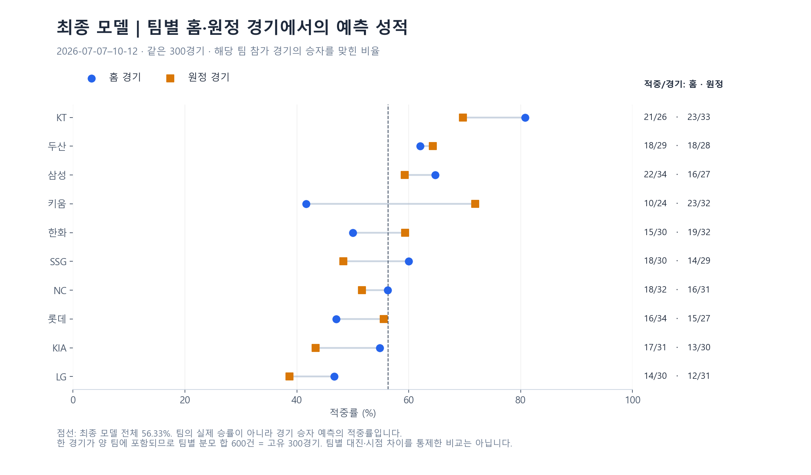

# 예측 성능 결산: 기간·팀·예측 강도별 결과

보존한 실제 예측을 재집계한 결과, 전체 639경기에서 356경기(55.71%), 최종 운영 모델의 300경기에서 169경기(56.33%)를 맞혔습니다. 아래는 **내부 예측 평가**이며 공식 팀 성적 54.6%와 분모가 다릅니다. 평균 성능뿐 아니라 어느 기간·팀·확률 구간에서 오차가 컸는지를 설명합니다.

[문서 목록](README.md) · [모델 구조](modeling.md) · [지표 계산 예제](evaluation-guide.md) · [대시보드](dashboard-showcase.md)

## 1. 평가 대상과 지표

| 평가 범위 | 기간·분모 | 결과 | 읽는 기준 |
| --- | --- | --- | --- |
| 주최 측 팀 페이지 | 2026-10-14 조회 | 16위·54.6%·게임 참여수 689·ALL KILL 5회 | 수동 제출과 여러 모델을 포함한 팀 기록. 참여수로 적중 수 역산 금지 |
| 전체 보존 예측 | 2026-04-11–10-12, 승패 639경기 | 356적중, 55.71% | 그날 실제 선택된 모델의 확률. 여러 버전 혼합 |
| 최종 모델 운영 | 2026-07-07–10-12, 승패 300경기 | 169적중, 56.33% | 실제 확률 출처가 pit_lgbm_v1인 경기 |
| 접수 증거를 전수 대조한 후기 구간 | 2026-08-03–10-12, 승패 218경기 | 126적중, 57.80%, Brier 0.24499 | 완료 223경기 중 무승부 5경기를 제외. 보존 예측과 마감 전 성공 접수 모두 확인 |

시즌 완료 일정은 720경기(승패 703·무승부 17), 보존된 완료 경기 예측은 655경기(승패 639·무승부 16)입니다. 기록 시작 전 55경기와 시작 후 예측 누락 10경기를 평가표에서 숨기지 않았습니다. 누락 10경기는 5월 7일 4경기·8일 5경기·6월 4일 1경기입니다. 취소 예측 17행은 완료 경기 성능 분모에서 제외합니다. 후기 구간은 접수 증거가 더 완전한 부분집합이며 별도의 추가 표본이 아닙니다.

전체 승패 원장에는 6월 2–7일의 28경기에 제출 캡처에서 복구했다는 출처 표시가 있습니다. 이 표시는 당시 입력·접수 증거를 모두 재검증했다는 의미는 아닙니다. 따라서 639경기 전체를 후기 218경기와 같은 수준으로 경기 전 제출까지 입증한 기록으로 해석하지 않습니다. 결과의 `auto_filled` 표시는 경기 후 정답·점수의 자동 반영이며, 사후에 예측값을 생성했다는 표시는 아닙니다.

홈 승리 확률을 p, 실제 홈 승리를 y=1, 원정 승리를 y=0으로 정의합니다.

| 지표 | 계산·방향 | 이번 결산에서의 역할 |
| --- | --- | --- |
| 적중률 | 맞힌 경기 수 / 평가 경기 수, 높을수록 좋음 | 승자 선택의 정확도. 제출 백분율을 소수 둘째 자리로 반올림한 뒤 50%는 실패 |
| Brier | mean((p − y)²), 낮을수록 좋음 | 확률 오차. 50% 고정 예측은 0.25 |
| LogLoss | −mean(y ln p + (1−y) ln(1−p)), 낮을수록 좋음 | 자신 있게 틀린 예측에 큰 불이익. 50% 고정 예측은 ln(2)=0.69315 |
| ROC-AUC | 홈 승리 경기를 더 높은 확률로 정렬하는 정도, 높을수록 좋음 | 임계값과 별도로 판별력을 확인. 무작위 순위 기준 0.5 |
| 보정·예측 강도 구간 | 평균 예측 확률과 실제 발생·적중 비율 비교 | 60%라고 말한 예측이 그 수준으로 실현됐는지 확인 |

Brier·LogLoss는 0–1 척도로 보존된 확률로 계산합니다. 운영 출력은 소수 넷째 자리까지 저장하므로, 반올림 전 추론값 전체를 사용한 점수는 아닙니다. 내부 원장의 639경기와 현 모델 300경기에는 반올림 후 정확히 50%인 예측이 없습니다. 확률 0.5의 수학적 기준선은 대회에서 유효한 승자 선택 전략과 다릅니다. Brier에는 판별력과 보정이 함께 반영되므로 보정만의 지표로 읽지 않습니다. [확률 보정의 정의](https://scikit-learn.org/stable/modules/calibration.html)

## 2. 전체 결과와 동일 경기 비교

| 대상 | 적중 / 경기 | 적중률 | Brier | LogLoss | ROC-AUC |
| --- | ---: | ---: | ---: | ---: | ---: |
| 전체 보존 운영 기록 | 356/639 | 55.71% | 0.24948 | 0.69371 | 0.56398 |
| 최종 직접 확률 LightGBM | 169/300 | 56.33% | 0.24559 | 0.68491 | 0.58632 |
| 같은 300경기의 기존 v13 비교 확률 | 163/300 | 54.33% | 0.25152 | 0.69753 | 0.57316 |
| 같은 300경기에서 항상 홈 승리 선택 | 153/300 | 51.00% | — | — | — |

전체 기록은 50% 고정 확률보다 Brier가 조금 낮지만 LogLoss는 조금 높습니다. 따라서 적중률 55.71%만으로 확률 예측 품질이 크게 개선됐다고 설명하지 않습니다. 항상 홈 승리 행은 승자 선택 기준선이라 확률 점수 칸을 비웠습니다.

현 모델과 기존 v13의 승자 선택이 달랐던 78경기에서 **현 모델만 적중 42, 기존 모델만 적중 36**으로 순증 6경기였습니다. 기존 비교값은 원장에 함께 보존된 legacy 확률로, 모든 경기에 결산 시점 모델을 새로 실행한 결과와 다릅니다.

| 차이: 현 모델 − 기존 v13 | 관측 차이 | 날짜별 부트스트랩 95% 구간 |
| --- | ---: | --- |
| 적중률 | +2.00%p | −3.90–+7.72%p |
| Brier | −0.00592 | −0.02105–+0.00882 |
| LogLoss | −0.01262 | −0.04438–+0.01844 |

날짜 단위로 5,000회 복원 추출했습니다. 모든 구간이 0을 포함합니다. 같은 날 경기 묶음은 유지하지만 여러 날의 팀·시리즈 의존성과 반복 후보 선택까지 완전히 반영한 구간은 아닙니다. 홈 승리 선택 대비 +5.33%p의 구간도 −1.36–+12.16%p로 0을 포함합니다. 관측된 개선과 안정적인 모델 우위는 구분합니다.

## 3. 기간별: 전체 시즌과 최종 모델을 나누어 보기


그림의 월별 막대는 여러 모델이 섞인 전체 보존 예측, 오른쪽은 최종 모델 300경기의 예측 강도 구간입니다. 실제 평가 집계이며 가상 UI 화면과 구분합니다.

### 전체 보존 예측의 월별 성적

| 월 | 적중 / 경기 | 적중률 | Brier | LogLoss |
| --- | ---: | ---: | ---: | ---: |
| 2026-04 | 43/81 | 53.09% | 0.25681 | 0.70700 |
| 2026-05 | 63/117 | 53.85% | 0.26389 | 0.72943 |
| 2026-06 | 68/119 | 57.14% | 0.24495 | 0.68205 |
| 2026-07 | 53/98 | 54.08% | 0.23866 | 0.66982 |
| 2026-08 | 45/83 | 54.22% | 0.25746 | 0.70953 |
| 2026-09 | 57/102 | 55.88% | 0.24784 | 0.68996 |
| 2026-10 | 27/39 | 69.23% | 0.21930 | 0.63076 |
| 전체 | 356/639 | 55.71% | 0.24948 | 0.69371 |

### 최종 모델만의 월별 성적

| 월 | 적중 / 경기 | 적중률 | Brier |
| --- | ---: | ---: | ---: |
| 2026-07 | 40/76 | 52.63% | 0.24312 |
| 2026-08 | 45/83 | 54.22% | 0.25746 |
| 2026-09 | 57/102 | 55.88% | 0.24784 |
| 2026-10 | 27/39 | 69.23% | 0.21930 |
| 전체 | 169/300 | 56.33% | 0.24559 |

7월은 7일 이후 현 모델 경기만 76건이며 전체 운영 98건과 다릅니다. 8월은 45/83, Brier 0.25746으로 50% 고정 기준보다 확률 오차가 컸고, 10월은 27/39, 69.23%로 높았습니다. 10월의 표본은 39경기라 시즌 평균을 대체할 대표 성적으로 쓰지 않습니다. 월별 대진·득점 환경·모델 변경을 통제한 인과 비교도 아닙니다.

## 4. 팀별·홈/원정: 어느 경기에서 어려웠는가

최종 모델의 같은 300경기(7월 7일–10월 12일)를 사용합니다. **팀별 적중률은 해당 팀이 참가한 경기의 승자를 맞힌 비율**입니다. 그 팀의 실제 승률이나 그 팀의 승리를 골랐을 때만의 적중률이 아닙니다. 홈/원정은 해당 팀의 경기 장소 역할입니다.

| 참가 팀 | 전체 적중 / 경기 (적중률) | 홈 경기 | 원정 경기 | Brier |
| --- | ---: | ---: | ---: | ---: |
| KT | 44/59 (74.58%) | 21/26 (80.77%) | 23/33 (69.70%) | 0.21071 |
| 두산 | 36/57 (63.16%) | 18/29 (62.07%) | 18/28 (64.29%) | 0.23349 |
| 삼성 | 38/61 (62.30%) | 22/34 (64.71%) | 16/27 (59.26%) | 0.22974 |
| 키움 | 33/56 (58.93%) | 10/24 (41.67%) | 23/32 (71.88%) | 0.24978 |
| 한화 | 34/62 (54.84%) | 15/30 (50.00%) | 19/32 (59.38%) | 0.24670 |
| SSG | 32/59 (54.24%) | 18/30 (60.00%) | 14/29 (48.28%) | 0.25609 |
| NC | 34/63 (53.97%) | 18/32 (56.25%) | 16/31 (51.61%) | 0.23882 |
| 롯데 | 31/61 (50.82%) | 16/34 (47.06%) | 15/27 (55.56%) | 0.26598 |
| KIA | 30/61 (49.18%) | 17/31 (54.84%) | 13/30 (43.33%) | 0.26008 |
| LG | 26/61 (42.62%) | 14/30 (46.67%) | 12/31 (38.71%) | 0.26348 |



KT 경기 44/59(74.58%)와 LG 경기 26/61(42.62%) 사이에 큰 편차가 있습니다. 키움은 홈 10/24와 원정 23/32로 나뉩니다. 같은 팀도 장소·대진·시점별 구성이 달라, 이 결과만으로 특정 팀 보정값을 만들거나 홈/원정이 오차의 원인이라고 단정할 수 없습니다.

한 경기가 양 팀 행에 포함되므로 팀별 분모 합은 600, 적중 합은 338입니다. 서로 다른 600경기가 아니라 **고유 300경기의 두 팀 관점 집계**입니다. 고유 경기 사이에도 같은 팀·시리즈의 의존성이 남습니다. 홈 열의 분모 합과 원정 열의 분모 합은 각각 300이며, 각 열 적중 합은 각각 169입니다. 팀별 Brier도 동일 경기 확률 오차를 해당 팀 참가 경기에서 평균한 값입니다.

### 선택한 승자가 홈팀인지에 따른 결과

| 모델이 선택한 쪽 | 적중 / 경기 | 적중률 | Brier | LogLoss |
| --- | ---: | ---: | ---: | ---: |
| 홈 승리 선택 | 102/182 | 56.04% | 0.24947 | 0.69321 |
| 원정 승리 선택 | 67/118 | 56.78% | 0.23961 | 0.67211 |

이는 바로 위의 팀별 홈/원정 구분과 다른 분할입니다. 예를 들어 KT가 홈이어도 모델이 상대 원정을 골랐다면 두 번째 행에 들어갑니다. 표본·대진 구성이 달라 이 표만으로 홈 편향이 없다고 확정하지 않습니다.

## 5. 예측 강도: 높은 확률을 얼마나 믿을 수 있었는가

선택한 승자의 확률 q=max(p, 1−p)로 묶었습니다. 구간은 하한 포함·상한 미포함이며 마지막은 70% 이상입니다.

| 예측 강도 | 적중 / 경기 | 평균 예측 확률 | 실제 적중률 | Brier |
| --- | ---: | ---: | ---: | ---: |
| 50–55% | 42/86 | 52.49% | 48.84% | 0.25005 |
| 55–60% | 54/94 | 57.58% | 57.45% | 0.24242 |
| 60–70% | 68/110 | 63.89% | 61.82% | 0.23961 |
| 70% 이상 | 5/10 | 71.90% | 50.00% | 0.30285 |

55–60% 구간은 평균 예측 57.58%와 실제 적중 57.45%가 가까웠습니다. 50–55% 접전은 42/86으로 판별이 약했고, 70% 이상은 평균 71.90%에 비해 5/10만 적중했습니다. 높은 확신에서의 과신 가능성을 점검할 근거지만, 10경기로 안정적인 보정 함수를 결정하기에는 부족합니다.

이 표는 선택한 승자 기준의 구간 진단입니다. 홈 승률 p와 실제 홈 승리 비율을 비교하는 일반적인 reliability curve와 구분합니다. 운영 인사이트 화면의 기본 5개 동일 표본수 보정 구간과도 경계가 다르므로 구간별 수치가 같을 필요는 없습니다. 현 모델의 사후 진단용 로지스틱 보정 기울기는 0.686이며 실제 적용한 보정이나 새로운 검증 성과가 아닙니다.

## 6. 모델 이력과 이후 경기의 그림자 평가

### 실제 확률 출처별 운영 기록

| 확률 출처 | 적중 / 경기 | 적중률 | Brier | LogLoss |
| --- | ---: | ---: | ---: | ---: |
| `predictor_v7` | 31/52 | 59.62% | 0.24827 | 0.68965 |
| `predictor_v12` | 26/53 | 49.06% | 0.26637 | 0.72976 |
| `predictor_v13` | 130/234 | 55.56% | 0.25090 | 0.69774 |
| `pit_lgbm_v1` | 169/300 | 56.33% | 0.24559 | 0.68491 |

평가 날짜가 다르므로 위 표를 모델 순위로 읽지 않습니다. 특히 초기 v7의 59.62%는 52경기이며, 최종 모델 300경기와 같은 조건의 비교가 아닙니다. 최종 모델의 학습·선택 당시 과거 재구성 403경기 점수 59.55%도 실전 운영 점수 56.33%와 분리합니다. [학습과 평가 시점](modeling.md)

9월 12일 고정한 그림자 후보는 **이후 9월 13일–10월 12일 91경기**에 저장된 확률로 평가했습니다. 실제 제출 모델은 계속 pit_lgbm_v1이었습니다.

| 모델 | 적중 / 경기 | 적중률 | 운영 모델 대비 추가 적중 | Brier |
| --- | ---: | ---: | ---: | ---: |
| 운영 pit_lgbm_v1 | 59/91 | 64.84% | 기준 | 0.22504 |
| relative_logistic_v1 | 64/91 | 70.33% | +5 | 0.21603 |
| blend_logistic_v1 | 64/91 | 70.33% | +5 | 0.21947 |
| relative_monotone_v1 | 57/91 | 62.64% | −2 | 0.22690 |
| blend_monotone_v1 | 61/91 | 67.03% | +2 | 0.22526 |

relative_logistic_v1의 +5.49%p 구간은 −2.33–+13.33%p로 0을 포함합니다. 네 후보를 함께 비교한 소표본 결과이며, 70.33%를 최종 제출 성적이나 전체 시즌 성적으로 소개하지 않습니다.

## 7. 수치 근거와 공개 재현 범위

집계 기준은 2026-10-13 시즌 결산이며 2026-10-15 원장을 읽어 전체·최종 모델·월별·팀별 홈/원정 수치를 다시 계산했습니다. 운영 기록과 모델은 수정하지 않았습니다.

| 로컬 보존 산출물 이름 | 확인한 내용 |
| --- | --- |
| season_audit.json | 완료 일정·보존 예측·누락·월별·모델 출처별 집계 |
| model_retrospective.json | Brier·LogLoss·AUC, 동일 경기 비교·부트스트랩, 확률 구간·선택 방향 |
| snapshot/results/accuracy.json | 639경기와 실제 확률 출처 기준 300경기를 독립 재집계. 팀별 홈/원정 표 추가 |
| model_training_metadata.json | 19개 입력·2025 학습 698경기·하이퍼파라미터·선택 당시 403경기 |
| shadow_comparison.json | 동결 후보의 이후 91경기 결과 |

위 파일은 공개 clone에 포함하지 않는 보존 근거의 식별명입니다. 보고용 집계 표·차트만 설명에 사용하며, 실제 경기번호·경기별 확률·접수 원장·API 응답·학습 가중치는 공개하지 않습니다. 공개 예제와 테스트는 계산 원칙을 검증하며 원본 시즌 성능 전체를 재생성하지는 않습니다. [자료 범위](data-policy.md)

### 공개 집계 차트 재생성

두 차트는 이 문서의 집계 표를 읽어 생성합니다. 원천 경기 파일이나 모델을 불러오지 않습니다. 표의 적중/경기 합계를 검사한 뒤 같은 그림을 만듭니다. 기본 데모와 달리 차트 생성에는 Matplotlib과 한국어 글꼴(맑은 고딕·Noto Sans CJK KR 등)이 필요합니다.

```bash
python -m pip install matplotlib
python tools/build_performance_figures.py
```

재현 범위는 **공개 표→차트**입니다. 비공개 원장→공개 표의 전체 재현과 구분합니다.
