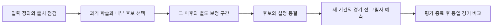

# 연구 고도화 계획: 입력 정합성에서 이후 기간 검증까지

현재 연구의 우선순위는 경기 전 입력의 정의·출처·이용 시각을 고정한 뒤, 투수 비율·상대 지표·확률 보정을 소수 후보로 검증하는 것입니다. 이 문서는 2026년 10월 13일 설계한 후속 실험이며, 실행 완료나 예측력 향상을 주장하지 않습니다.

[문서 목록](README.md) · [시즌 결과와 회고](season-review-2026.md) · [참고 문헌](references.md) · [실험 기록 양식](experiment-log.md)

2026-10-14 확장: 이 문서는 모델·입력 실험 E0–E5를 유지합니다. 데이터마트·예측 시점·포스트시즌·시리즈·운영 효과·공개 재현을 비교한 [발전 방향 R0–R7](development-roadmap.md)을 추가했습니다. 실제 연구는 설계 단계이고 시리즈 계산만 독립 합성 예제로 구현했습니다.

## 판단의 출발점

시즌 점검에서 실제 제출 기록의 범위, 과거 재구성과 실전 입력의 정의, 같은 경기에서 비교하는 모델의 역할을 먼저 정리해야 한다는 과제를 확인했습니다. 관측 결과를 다시 후보 선택에 쓰면 다음 평가의 독립성이 사라집니다. 따라서 새 알고리즘을 많이 비교하는 것보다 검증 조건을 고정하는 일을 앞에 둡니다. 선택 과정 자체의 과적합 위험은 [Cawley·Talbot, 2010](https://www.jmlr.org/beta/papers/v11/cawley10a.html)에서 다룹니다.

승자 적중률, 확률 품질, 제출 완결성을 각각 보고합니다. Brier·LogLoss는 확률 예측을 평가하지만 Brier 감소 하나가 보정 개선만을 뜻하지는 않습니다. [Gneiting·Raftery, 2007](https://sites.stat.washington.edu/people/raftery/Research/PDF/Gneiting2007jasa.pdf), [scikit-learn 보정 문서](https://scikit-learn.org/stable/modules/calibration.html)에 근거해 판별·보정 곡선·표본 수를 함께 기록합니다.

## 실험 우선순위와 통과 기준

| ID | 검증할 가설·질문 | 설계 | 통과 기준 |
| --- | --- | --- | --- |
| E0 | 학습과 실전에서 같은 이름의 입력이 같은 의미인가? | 원천·단위·누적 종료일·가용 시각·기본값·결측 처리를 변수별로 대조 | 출처와 정의가 설명되지 않는 입력은 학습·실전 정합성을 통과한 것으로 표시하지 않음 |
| E1 | 원시 투수 카운트와 표본 수축이 비율의 불안정성을 줄이는가? | 예측일 이전 SO·BB·TBF, K%·BB%·K%-BB%, 표본 수를 기존 비율과 비교 | 미래 기록 제외, 카운트 무결성, 같은 날짜 분할의 확률·적중 비교와 불확실성 보고 |
| E2 | 득점 환경에 대한 상대 지표가 시즌 간 차이를 줄이는가? | 팀 득실점과 예측 시점 이전 리그 평균의 상대값을 로지스틱·소형 트리에 사용 | 분할 안에서 전처리·평균을 계산하고 절대값 입력과 같은 경기에서 비교 |
| E3 | 낮은 자유도의 보정이 확신의 강도를 개선하는가? | 별도 과거 보정 구간에서 양의 온도 또는 로지스틱 보정 학습 | 이후 구간의 Brier·LogLoss·보정 곡선 및 반올림 후 50% 발생 확인 |
| E4 | 관측한 개선이 기간·시리즈 의존성에도 유지되는가? | 날짜 묶음 비교와 연속 날짜 블록의 민감도 검사 | 같은 경기의 두 모델 차이, 기간별 표본 수와 구간을 함께 보고 |
| E5 | 연구 후보가 실제 운영 조건에서도 재현되는가? | 아티팩트·입력·설정을 동결하고 이후 허용된 시즌에서 그림자 예측 보존 | 경기 전 생성·모델 재현 확인. 대회 제출 모드에서는 마감 전 접수도 확인, 평가 종료 전 재튜닝하지 않음 |

모든 실험은 현재 **설계** 상태입니다. 통과 기준을 적었다는 사실은 성능 개선을 확인했다는 뜻이 아닙니다.

## E0 — 입력 정의와 시점 고정

각 입력에 원천, 계산식, 단위, 예측일, 누적 종료 시점, 취득 시각, 이용 가능 시각, 원본 보관 식별자, 결측 사유와 기본값 정책을 붙입니다. 필드 이름이 같아도 기간·분모·계산식이 다르면 다른 버전의 입력으로 취급합니다.

기본값 0, 정상적으로 측정된 0, 응답 없음과 계산 불가를 구별합니다. 사후 재구성에서 대부분 같은 값인 변수는 실제 차이가 작은 것인지, 누락을 기본값으로 바꾼 것인지 먼저 확인합니다. 자료를 가져온 시각만으로 과거 경기 전에 공개됐다고 판단하지 않습니다.

한 경기마다 입력·모델·확률·접수·결과를 연결하는 고유 키를 유지합니다. 취소 뒤 재편성된 경기의 새 경기번호와 수동 기록의 별도 식별자를 원본을 보존한 매핑으로 연결합니다. 시즌 최종 누적값이나 경기 후 확정 라인업을 과거 예측 입력에 넣지 않습니다. [scikit-learn 누출 방지](https://scikit-learn.org/stable/common_pitfalls.html)

## E1 — 투수 원시 카운트와 표본 수축

K%는 SO/TBF, BB%는 BB/TBF로 계산하고, 두 비율의 차이와 TBF를 함께 사용합니다. 원시 카운트가 없는 기존 K/BB 비율에서 이 지표를 역산하지 않습니다. [FanGraphs의 비율 정의](https://library.fangraphs.com/pitching/rate-stats/)는 개념 근거이며, MLB 수치·판정 기준·표본 안정화 임계값을 KBO 입력에 이식하지 않습니다.

다음은 검증할 수축 후보입니다. 코드 블록의 식은 연구 설계용 정의입니다.

```text
k_rate_shrunk  = (SO + prior_strength * prior_k_rate)  / (TBF + prior_strength)
bb_rate_shrunk = (BB + prior_strength * prior_bb_rate) / (TBF + prior_strength)
kbb_diff_shrunk = k_rate_shrunk - bb_rate_shrunk
```

사전 비율과 수축 강도는 학습 구간 안에서 추정·선택합니다. 전체 시즌 또는 평가 구간의 합계로 정하지 않습니다. 같은 수축 강도를 사용하는 SO·BB·나머지 결과의 카운트 구조를 유지하고 SO+BB≤TBF를 검사합니다. TBF=0은 무관측 상태로 남겨 사전값과 결측 표시를 함께 제공합니다.

최근 구간과 누적 구간은 독립 후보로 관리합니다. 선발·구원 역할의 정의와 극소 표본은 따로 기록합니다. 가용 시각을 입증할 수 없다면 보수적으로 이전 날짜까지 합산하고 당일 경기 전체를 제외합니다. 무승부 경기의 과거 투구 기록은 정규시즌 관측 카운트에 포함할 수 있으며, 승패 학습 라벨의 제외 조건과 혼동하지 않습니다.

## E2 — 상대 지표와 단순 비교 모델

팀의 경기당 득점·실점을 예측 시점 이전 리그 평균에 대한 상대값으로 구성하는 후보를 검토합니다. 리그 평균은 팀 평균의 단순 평균 대신 허용 자료의 득점 합계와 팀·경기 수에서 계산합니다. 0인 분모와 결측은 별도 처리합니다. 이 상대값을 wRC+나 구장 보정 지표와 동일하다고 부르지 않습니다.

비교 모델은 과거 홈 승률 기준, 상대 지표 로지스틱, 규제를 둔 소형 LightGBM, 현재 동결 운영 모델로 제한합니다. 로지스틱 표준화, 결측 처리, 리그 기준은 각 학습 구간에서만 맞춥니다. 입력 그룹 제거 실험도 같은 분할을 유지합니다.

표 형식 자료에서 모델 계열 선택보다 자료 특성과 튜닝 조건이 중요할 수 있다는 [McElfresh 등, 2023](https://proceedings.neurips.cc/paper_files/paper/2023/hash/f06d5ebd4ff40b40dd97e30cee632123-Abstract-Datasets_and_Benchmarks.html)의 결과를 참고했습니다. 이 논문이 KBO에서 트리나 로지스틱의 우월성을 입증하는 것은 아닙니다. 복잡한 스태킹·신경망 확대는 입력 정합성과 작은 비교군의 검증 뒤에 검토합니다.

## E3 — 확률 보정과 제출 경계

보정 자료는 기본 모델 학습 자료와 구분하고, 보정값 선택 이후의 구간에서 평가합니다. 표본이 제한된 현재 연구에는 자유도가 작은 후보부터 비교하는 설계를 택합니다. 작은 보정 표본에서 isotonic의 과적합 위험을 다루는 [Niculescu-Mizil·Caruana, 2005](https://www.cs.cornell.edu/~alexn/papers/calibration.icml05.crc.rev3.pdf)와 [scikit-learn 문서](https://scikit-learn.org/stable/modules/calibration.html)를 참고했습니다.

양의 온도 T를 쓰는 `sigmoid(logit(p)/T)`는 반올림 전 0.5 경계와 확률 순서를 유지합니다. 이 후보의 목적은 확률의 강도 조정입니다. 절편을 추가한 보정은 승자 경계도 바꿀 수 있으므로 별도 실험으로 기록합니다. 온도 보정의 개념은 [Guo 등, 2017](https://proceedings.mlr.press/v70/guo17a.html)을 참고하되, 논문의 신경망 실험 성과를 현행 LightGBM의 개선으로 간주하지 않습니다.

최종 제출 정밀도로 반올림한 확률이 50.00%가 되는 경기를 별도 집계합니다. 보정으로 접전에 가까워진 값을 임의로 50.01%로 바꿔 성능을 보완하지 않습니다. 원확률·보정확률·제출값을 각각 보존하고 실제 접수된 값을 채점합니다. 회고 자료에 맞춘 보정 기울기는 진단으로만 사용하며 같은 자료에서 새 독립 성능을 주장하지 않습니다.

## 날짜순 검증 프로토콜



1. 누적값을 예측 시점 이전으로 제한하고 같은 날짜의 경기는 같은 분할에 넣습니다.
2. 과거 구간 안에서 날짜순 내부 검증으로 후보를 고릅니다. 보정이 후보 선택의 일부라면 보정까지 포함한 전체 파이프라인을 내부 검증합니다.
3. 최종 후보에는 그 이후의 별도 구간에서 보정값을 고정합니다. 최종 평가 자료는 학습·튜닝·보정에 쓰지 않습니다.
4. 이미 여러 차례 확인한 2026년 자료는 다음 연구의 개발·회고 자료로 표시합니다. 새로운 독립 최종 평가는 이후 허용된 시즌이나 별도로 잠가둔 미래 구간으로 정합니다.
5. 이전 시즌 입력의 복구·가용 시각을 검증하지 못하면 다년 검증 완료로 표시하지 않습니다. 회고 재구성과 실제 경기 전 입력의 출처도 각각 유지합니다.

[TimeSeriesSplit 문서](https://scikit-learn.org/stable/modules/generated/sklearn.model_selection.TimeSeriesSplit.html)는 동일 기간 비교에 표본 간격 조건이 있음을 설명합니다. KBO는 휴식일과 날짜별 경기 수가 달라 행 개수 기반 분할만으로 동일 기간을 보장할 수 없습니다. 날짜 경계를 명시한 분할을 사용하고, gap은 단순 관행값 대신 자료의 가용 시각·라벨 지연과 겹치는 관측 구간에 근거해 정합니다.

## E4 — 차이의 불확실성과 설명 검증

같은 경기에서 두 모델의 손실과 적중 차이를 구합니다. 항상 홈 승리 같은 승자 선택 기준과 고정 과거 홈 승률 같은 확률 기준은 역할을 구분합니다. 정확히 50%인 확률은 Brier 기준값이 될 수 있지만 대회에서의 승자 선택 기준으로는 실패입니다.

날짜 묶음 재표집은 같은 날의 공통 환경을 유지하지만 며칠 이어지는 팀·시리즈 의존성을 모두 반영하지는 못합니다. 1일 묶음과 사전에 정한 연속 3일·7일 블록을 민감도 후보로 비교합니다. 한 경기를 양 팀으로 두 번 늘려 표본 수를 부풀리지 않습니다. [Politis·Romano, 1994](https://www.tandfonline.com/doi/abs/10.1080/01621459.1994.10476870)의 의존 관측 재표집 개념을 참고하되, 정상성 등 조건이 필요한 방법을 시즌 전체에 무조건 적용하지 않습니다. 구간·블록 선택을 좋은 결과에 맞춰 바꾸지 않습니다.

트리 gain, 단순 순열 중요도, 특정 팀의 정확도는 인과적 기여나 안정적 실력 차이로 해석하지 않습니다. 상관된 입력은 그룹별 제거 실험과 같은 날짜 검증으로 함께 봅니다. [scikit-learn 순열 중요도](https://scikit-learn.org/stable/modules/permutation_importance.html)

## E5 — 이후 운영과 채택 판단

| 관점 | 남길 항목 |
| --- | --- |
| 자료 | 입력 버전, 원천, 이용 가능 시각, 보존 파일의 해시 |
| 모델 | 학습 종료일, 아티팩트·설정의 해시, 전체 튜닝 시도 수 |
| 예측 | 경기번호, 생성 시각, 원확률·보정확률·제출값 |
| 제출 | 대회 제출 모드: 마감·접수 시각, 성공 응답, 최종 접수값 일치. 자체 평가: not_applicable |
| 평가 | 평가 날짜·경기 수, 제외·누락 사유, 적중·Brier·LogLoss·AUC, 보정 곡선 |
| 판단 | 기준 모델과의 동일 경기 차이, 구간, 실패·기각 사유, 다음 평가 시점 |

자료·예측 기록 무결성을 먼저 통과한 후보만 성능 채택 대상으로 검토합니다. 대회 제출 모드에서는 접수 무결성을 추가 확인합니다. 제출 없는 평가에서는 접수율을 적용하지 않고 [포스트시즌 프로토콜](postseason-protocol.md)의 경기 전 고정·기록 확보율을 사용합니다. 적중률과 확률 품질의 채택 기준, 운영상 허용 악화 폭, 평가 기간과 종료 조건은 다음 실행 전에 수치로 고정해야 합니다. 이 문서에서는 아직 정하지 않은 허용 폭을 임의로 채워 이미 등록된 프로토콜처럼 표현하지 않았습니다.

외부 문헌은 방법 선택의 근거로만 사용합니다. 모델 입력에는 참가 조건상 허용된 자료만 사용하고, 기존 결과 수집·평점 갱신 경로의 원천 조건도 확인합니다. 실제 데이터 수집·새 모델 학습·서버 전환은 이번 문서 작업에서 실행하지 않았습니다. [자료 정책](data-policy.md)
